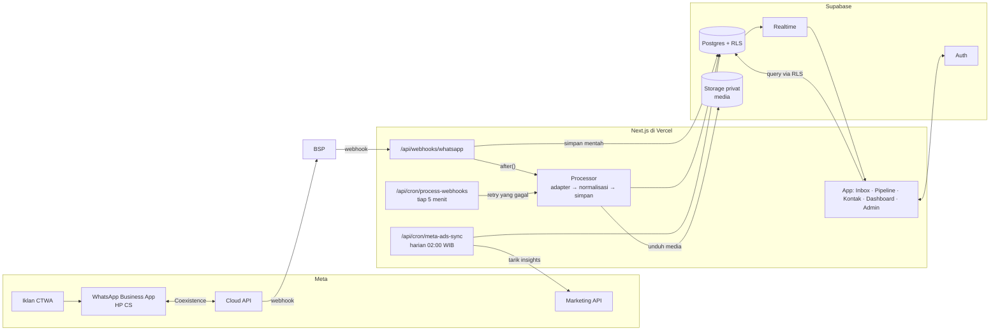
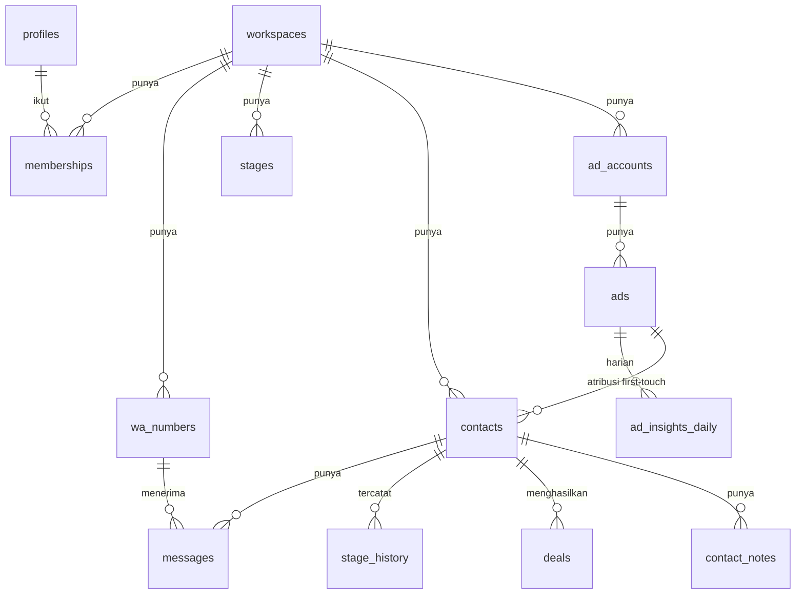
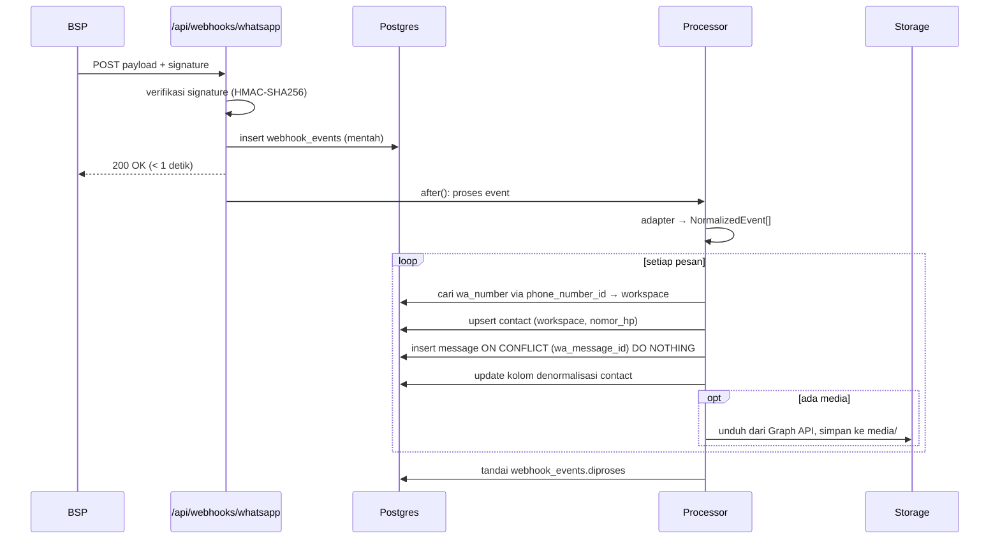

# Arsitektur — Connectiv (Pilot + MVP)

Dokumen ini menjabarkan PRD v0.2 (`docs/PRD.md`) menjadi desain teknis. Jika ada yang bertentangan, PRD yang menentukan *apa*, dokumen ini menentukan *bagaimana*.

---

## 1. Gambaran besar



Prinsip utama:
1. **Webhook tidak boleh lambat atau hilang.** Payload mentah disimpan dulu, baru diproses. Yang gagal diulang oleh cron.
2. **Isolasi workspace ada di database**, bukan di kode aplikasi. Semua akses dari UI lewat RLS dengan sesi user. Secret key Supabase (`sb_secret_…`, melewati RLS) hanya dipakai di webhook dan cron.
3. **BSP bisa diganti.** Semua format luar diubah ke satu tipe internal (`NormalizedEvent`) oleh adapter.
4. **Inbox harus cepat.** Data yang sering ditampilkan (pesan terakhir, status menunggu) didenormalisasi ke tabel `contacts`.

---

## 2. Stack

| Lapisan | Pilihan | Catatan |
|---|---|---|
| Framework | Next.js 16 (App Router, TypeScript, Server Components, Server Actions, `cacheComponents`) | `after()` untuk proses setelah respon, `proxy.ts` untuk refresh sesi |
| UI | Tailwind CSS + shadcn/ui, ikon lucide-react, chart Recharts | Bahasa UI Indonesia, format `id-ID`, zona waktu `Asia/Jakarta` |
| Data fetching klien | Supabase JS (`@supabase/ssr`) + TanStack Query untuk cache inbox | Realtime lewat `supabase.channel()` |
| Database | Supabase Postgres + RLS | Migrasi SQL via Supabase CLI (`supabase/migrations`) |
| Auth | Supabase Auth (email + password, opsi magic link) | Undangan user oleh Owner/Super Admin |
| Storage | Supabase Storage, bucket privat `media` | Akses via signed URL (berlaku 1 jam) |
| Hosting + cron | Vercel (Hobby untuk pilot, Pro saat berbayar) | Cron Vercel memanggil route dengan `CRON_SECRET` |
| Test | Vitest (unit + integrasi), Playwright (opsional, alur utama) | RLS diuji dengan dua user di dua workspace |
| Validasi | Zod | Payload webhook, input form, env |

---

## 3. Struktur folder

```
connectiv/
├─ app/
│  ├─ (auth)/login/                     # halaman login
│  ├─ (app)/w/[slug]/                   # semua halaman per workspace
│  │  ├─ inbox/                         # daftar chat + panel percakapan
│  │  │  └─ [contactId]/
│  │  ├─ pipeline/                      # kanban
│  │  ├─ kontak/                        # tabel kontak + detail
│  │  ├─ dashboard/                     # performa iklan, funnel, lost, respon
│  │  └─ pengaturan/                    # user, stage, nomor WA, batas waktu
│  ├─ admin/                            # Super Admin: workspace, nomor, sync, log
│  └─ api/
│     ├─ webhooks/whatsapp/route.ts     # GET verifikasi, POST terima event
│     └─ cron/
│        ├─ process-webhooks/route.ts
│        └─ meta-ads-sync/route.ts
├─ components/                          # komponen UI (shadcn di components/ui)
├─ lib/
│  ├─ supabase/                         # client server, browser, service-role
│  ├─ whatsapp/
│  │  ├─ types.ts                       # NormalizedEvent
│  │  ├─ signature.ts                   # verifikasi X-Hub-Signature-256
│  │  ├─ adapters/meta.ts               # format asli Meta
│  │  ├─ adapters/<bsp>.ts              # jika BSP mengubah format
│  │  ├─ processor.ts                   # simpan pesan, kontak, atribusi
│  │  └─ media.ts                       # unduh media ke Storage
│  ├─ meta-ads/sync.ts
│  ├─ auth/roles.ts                     # helper peran di server
│  └─ format.ts                         # rupiah, waktu relatif, nomor HP
├─ supabase/
│  ├─ migrations/                       # skema + RLS + fungsi
│  └─ seed.sql                          # data contoh untuk dev
├─ tests/
│  ├─ fixtures/webhooks/                # payload contoh dari dokumentasi Meta
│  ├─ whatsapp/                         # adapter + processor
│  └─ rls/                              # isolasi workspace & peran
├─ docs/                                # PRD, arsitektur, task
└─ CLAUDE.md
```

---

## 4. Model data

Mengikuti PRD bagian 4, dengan tambahan yang dibutuhkan untuk implementasi (ditandai ➕).



| Tabel | Kolom penting | Catatan |
|---|---|---|
| `workspaces` | id, nama, ➕slug (unik), batas_kuning_menit (15), batas_merah_menit (60), ➕zona_waktu | slug dipakai di URL `/w/[slug]` |
| ➕`profiles` | id (= `auth.users.id`), email, nama, ➕is_super_admin | pengganti tabel `users` karena auth dikelola Supabase |
| `memberships` | user_id, workspace_id, peran (`owner`/`supervisor`/`cs`) | PK gabungan |
| `wa_numbers` | id, workspace_id, phone_number_id (**unik global**), waba_id, label, nomor_tampil, status, terakhir_terima_pesan | `phone_number_id` dari webhook menentukan workspace |
| `contacts` | id, workspace_id, nomor_hp (E.164), nama, assigned_to, stage_id, ad_id, ctwa_clid, ➕referral_headline, ➕referral_source_url, sumber (`ctwa`/`organik`), pesan_terakhir_pada, ➕pesan_terakhir_cuplikan, arah_pesan_terakhir, menunggu_balasan_sejak, ➕wa_number_id_terakhir, dibuat_pada | **unik (workspace_id, nomor_hp)** |
| `messages` | id, workspace_id, contact_id, wa_number_id, wa_message_id (**unik**), arah (`masuk`/`keluar`), tipe, isi, ➕media_path, ➕media_mime, ➕dari_history, dikirim_pada | `media_path` = path di Storage, bukan URL Meta |
| `stages` | id, workspace_id, nama, urutan, tipe (`normal`/`closing`/`lost`) | dibuat otomatis saat workspace dibuat |
| `stage_history` | id, contact_id, dari_stage, ke_stage, oleh_user, pada | ditulis oleh trigger saat `stage_id` berubah |
| `deals` | id, contact_id, ➕workspace_id, status, nilai, alasan_lost, catatan, ➕oleh_user, pada | `alasan_lost` = enum tetap |
| ➕`contact_notes` | id, contact_id, workspace_id, isi, oleh_user, pada | catatan internal (F5) |
| `ad_accounts` | id, workspace_id, meta_ad_account_id, status_sync, ➕terakhir_sync_pada, ➕error_terakhir | |
| `ads` | id, workspace_id, meta_ad_id (**unik per workspace**), nama_iklan, nama_adset, nama_campaign, ➕status | dibuat juga saat referral muncul sebelum sync |
| `ad_insights_daily` | ad_id, tanggal, spend, impressions, klik, percakapan_dimulai | **unik (ad_id, tanggal)**, upsert |
| `webhook_events` | id, sumber, payload_mentah (jsonb), ➕signature_valid, diproses (bool), ➕percobaan, error, diterima_pada, ➕diproses_pada | disimpan 90 hari |
| ➕`sync_runs` | id, jenis, workspace_id, mulai, selesai, status, error | log sinkronisasi untuk Super Admin |
| ➕`admin_access_log` | id, user_id, workspace_id, aksi, pada | log akses Super Admin (PRD §6) |

**Keputusan model yang perlu dikonfirmasi:** pipeline berbasis **kontak** (satu kontak = satu kartu). Kontak yang sudah Closing/Lost lalu chat lagi akan **dibuka ulang ke stage "Baru"**, sementara riwayatnya tetap di `deals` dan `stage_history`. Kalau klien pilot banyak repeat order, kita pertimbangkan pipeline berbasis deal sebelum Sprint 4.

---

## 5. Keamanan & multi-tenant

### 5.1 Fungsi bantu (SQL, `security definer`, `stable`)
- `is_member(ws uuid)` → user saat ini anggota workspace?
- `role_in(ws uuid)` → peran user di workspace.
- `is_super_admin()` → dari `profiles.is_super_admin`.

### 5.2 Kebijakan RLS
| Tabel | Owner | Supervisor | CS |
|---|---|---|---|
| `contacts`, `messages`, `deals`, `contact_notes`, `stage_history` | baca/ubah semua di workspace | baca semua, assign, ubah stage | **hanya kontak yang `assigned_to = auth.uid()`** |
| `stages`, `wa_numbers` (label), pengaturan workspace | kelola | baca | baca |
| `memberships` | kelola | baca | baca diri sendiri |
| `ads`, `ad_insights_daily`, dashboard | baca | baca | tidak (MVP) |
| `webhook_events`, `sync_runs`, `admin_access_log` | — | — | — (hanya Super Admin / service role) |

Super Admin mengakses workspace klien lewat halaman `/admin`, dan setiap akses tercatat di `admin_access_log`.

### 5.3 Rahasia (environment variable)
`NEXT_PUBLIC_SUPABASE_URL`, `NEXT_PUBLIC_SUPABASE_PUBLISHABLE_KEY`, `SUPABASE_SECRET_KEY`, `WHATSAPP_VERIFY_TOKEN`, `WHATSAPP_APP_SECRET` (atau secret BSP), `WHATSAPP_ACCESS_TOKEN` (unduh media), `META_ADS_ACCESS_TOKEN` (system user Delegativ dengan akses partner ke ad account klien), `CRON_SECRET`. Divalidasi dengan Zod saat start.

### 5.4 Test isolasi (wajib, Sprint 1)
Dua workspace (A, B), masing-masing dengan Owner dan CS. Test memastikan: user A tidak bisa membaca/mengubah satu baris pun milik B di setiap tabel, CS hanya melihat kontak yang di-assign, dan langganan Realtime B tidak menerima event A.

---

## 6. Alur webhook WhatsApp



- **GET** (verifikasi pendaftaran): cocokkan `hub.verify_token`, balas `hub.challenge`.
- **Signature tidak valid**: tetap simpan dengan `signature_valid = false`, balas 401, tidak diproses.
- **Retry**: cron `process-webhooks` mengambil event `diproses = false` dengan `percobaan < 5`, backoff berdasarkan `diterima_pada`.
- **Idempoten**: dijamin oleh unique `wa_message_id`. Event yang sama dua kali tidak menggandakan pesan maupun memajukan status.

### 6.1 `NormalizedEvent`
```ts
type NormalizedEvent =
  | { kind: 'message'; phoneNumberId: string; waMessageId: string;
      direction: 'masuk' | 'keluar';           // messages = masuk, smb_message_echoes = keluar
      customerPhone: string; customerName?: string;
      type: 'text' | 'image' | 'document' | 'audio' | 'video' | 'sticker' | 'location' | 'other';
      text?: string; media?: { id: string; mime: string; filename?: string };
      referral?: { adId: string; headline?: string; sourceUrl?: string; ctwaClid?: string };
      sentAt: Date; fromHistory: boolean }
  | { kind: 'status'; waMessageId: string; status: 'sent' | 'delivered' | 'read' | 'failed'; at: Date }
  | { kind: 'unknown'; raw: unknown };
```

### 6.2 Aturan pemrosesan
| Situasi | Aksi |
|---|---|
| Kontak baru | buat dengan stage tipe `normal` urutan pertama ("Baru"), `sumber = organik` |
| Pesan masuk membawa `referral` dan kontak belum punya `ad_id` | isi `ad_id`, `ctwa_clid`, headline, `sumber = ctwa` (**first-touch**, tidak pernah ditimpa). Buat baris `ads` minimal jika belum ada |
| Pesan masuk, `menunggu_balasan_sejak` kosong | isi dengan `sentAt` (kecuali `fromHistory` dan lebih tua dari 7 hari) |
| Pesan keluar (echo CS) | kosongkan `menunggu_balasan_sejak` |
| Selalu | perbarui `pesan_terakhir_pada`, `arah_pesan_terakhir`, cuplikan **hanya jika `sentAt` lebih baru** (aman untuk history yang datang tidak urut) |
| Kontak di stage Closing/Lost menerima pesan masuk baru (bukan history) | buka ulang ke "Baru" (lihat keputusan §4) |
| `wa_numbers.terakhir_terima_pesan` | diperbarui setiap event, dasar status koneksi |

---

## 7. Realtime

- Klien berlangganan `postgres_changes` pada `messages` dan `contacts` dengan filter `workspace_id=eq.<id>`. RLS tetap berlaku pada Realtime.
- Inbox: event `contacts` UPDATE → urutkan ulang daftar; event `messages` INSERT → tambahkan ke percakapan yang sedang dibuka.
- Pipeline: event `contacts` UPDATE (`stage_id`) → pindahkan kartu, sehingga dua supervisor melihat perubahan yang sama.
- Waktu relatif ("12 mnt lalu") dihitung di klien dengan timer 30 detik, tanpa query ulang.

---

## 8. Sinkronisasi Meta Ads

- Cron harian 02:00 WIB (`0 19 * * *` UTC). Untuk setiap `ad_accounts` aktif: tarik insights `level=ad`, `time_increment=1`, rentang **3 hari terakhir** (data Meta masih bisa berubah), field `spend, impressions, clicks, actions`. `percakapan_dimulai` diambil dari action `onsite_conversion.messaging_conversation_started_7d`.
- Upsert `ads` (nama iklan, ad set, campaign) dan `ad_insights_daily`.
- Setiap run dicatat di `sync_runs`. Kegagalan mengisi `ad_accounts.error_terakhir` dan muncul di halaman Admin.
- Tombol "Sync sekarang" di Admin memanggil fungsi yang sama untuk satu ad account.
- Akses: Delegativ memakai satu **system user token** di Business Manager sendiri, dengan akses partner (read-only) ke ad account klien. Satu token di env var, sesuai PRD §6.

---

## 9. Dashboard (query)

Dibuat sebagai fungsi SQL (`rpc`) dengan parameter `ws, dari, sampai, wa_number_id?`, berjalan di bawah RLS:

| Fungsi | Isi |
|---|---|
| `dashboard_ads` | per iklan: spend, chat (kontak dengan `ad_id` itu yang dibuat di rentang), closing, revenue, biaya/chat, **biaya/closing**, ROAS. Baris "Organik / Tidak diketahui" untuk kontak tanpa `ad_id` |
| `dashboard_funnel` | jumlah kontak yang pernah mencapai setiap stage (dari `stage_history`), dan persentase lanjut |
| `dashboard_lost_reasons` | distribusi `alasan_lost` |
| `dashboard_response_time` | median & P90 waktu dari pesan masuk pertama yang belum dibalas sampai balasan keluar berikutnya, hanya pesan non-history. Per hari dan per CS yang di-assign |

Kohort: chat dan closing dihitung berdasarkan **tanggal kontak dibuat**, supaya biaya per closing per iklan konsisten dengan spend di periode yang sama.

---

## 10. Lingkungan

| Lingkungan | Supabase | Vercel | Nomor WA |
|---|---|---|---|
| Dev (laptop) | project `connectiv-dev` di cloud (tanpa Docker) | `npm run dev` | payload contoh dari fixtures |
| Staging | `connectiv-dev` | Preview deployment | nomor internal Delegativ |
| Produksi | `connectiv-prod` | Production | nomor klien pilot |

Migrasi dijalankan dengan `supabase db push` ke project tujuan. Test RLS berjalan terhadap project dev.

---

## 11. Observabilitas

- Halaman Admin: status setiap nomor WA (aktif jika ada event dalam 24 jam), jumlah webhook gagal, sync terakhir per ad account.
- Log terstruktur di route webhook dan cron (terlihat di Vercel Logs).
- Metrik pilot (PRD §2.8) dihitung dengan query manual di SQL editor selama pilot.

---

## 12. Keputusan & risiko terbuka

| # | Hal | Status |
|---|---|---|
| 1 | BSP pilot (wajib format asli Meta, Coexistence, `history`, `smb_message_echoes`) | **Belum dipilih**, menghambat uji nyata Sprint 2 (kode tetap bisa jalan dengan fixture) |
| 2 | Pipeline berbasis kontak, buka ulang saat repeat | Usulan, perlu konfirmasi |
| 3 | Jam operasional untuk waktu respon | Belum: MVP menghitung 24 jam |
| 4 | Batas Vercel Hobby (cron harian saja, durasi fungsi) | Cron 5 menit untuk retry butuh Pro, atau ganti dengan Supabase `pg_cron` |
| 5 | Kecocokan `referral.source_id` dengan `ad_id` Marketing API | Diverifikasi saat uji di nomor internal |
